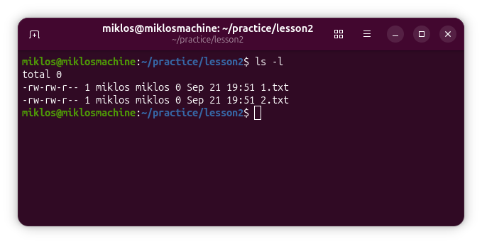
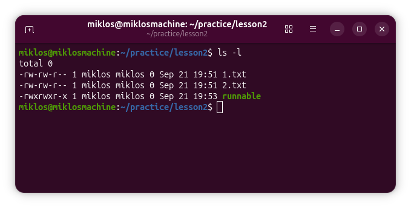
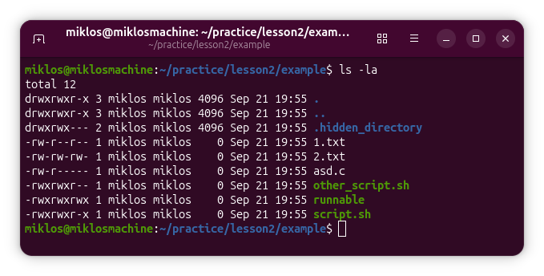
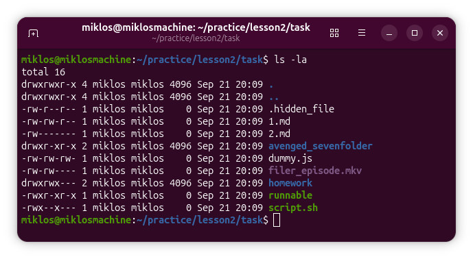

# Lesson 2

**Preparation:** Let's create a separate folder for the tasks of this exercise,
and go into it! Create any text files in it.

```bash
cd practice #if created last week, else first run -> mkdir practice
mkdir lesson2
cd lesson2
touch 1.txt
touch 2.txt
```

After that, we can start the new material!

## Permissions

In the previous lesson, we learned how to navigate the file system in a terminal.
However, we didn't look at what permissions there are, how to view them,
how Linux stores them, and how to change them.

Viewing permissions is quite simple, and we've already learned how to do it. Let's execute
the following command in the `lesson2` folder.

```bash
ls -l
```

So far, we haven't looked closely at what exactly the `ls` command prints when combined with the `-l` switch. The image below shows a possible output:



In this case, the following columns appear.
1. Permissions. We will clarify its interpretation shortly.
2. Hard link (For standard files, this value is typically 1, while for directories, it starts at 2 and increases by 1 for every immediate subdirectory they contain due to internal parent-child references)
3. Owner. Usually the same as the user who created the file.
4. Group. We will discuss this in more detail shortly.
5. Size. We see it given in bytes.
6. Last modification time.
7. Name.

Let's move on to the permissions column!

### Permissions for simple files
On a Unix-based system, we distinguish three types of permissions:
- read (**r**ead),
- write (**w**rite),
- execute (**e**x**ecute).

The permissions are interpreted for three types of users for each element. These users are:
- the owner,
- users in the owner's group,
- everyone else.

Accordingly, there are 3x3 rights for a file, so 9. Consider the screenshot below:



The file `runnable` has the right to be written, read and executed by everyone. This is indicated by the `rwxrwxrwx` in front of the file. In contrast, the two text files are only writable by the owner and
members of the owner's group, but everyone has the right to read them.
No one has the right to execute the text files (there would be no point in executing a text file).

You can see that the rights that are not given are marked with a '-' character (dash).
The corresponding character is printed for those that are given. The first triple `rwx` group represents the rights of the
owner, the second group represents those in the owner's group, and the third group represents everyone else.

Note that you also need write permission to delete the file.

### Permissions as numbers
To be able to change these permissions, let's first look at how the system
represents them!

Permissions are traditionally represented by numbers in Unix systems. The numbers are formed as follows:
- `r` = 4
- `w` = 2
- `x` = 1

The numbers are apparently powers of two (second, first and zeroth powers). If we sum them, we get the rights that apply to the file. For example, if we start from the rights of the file `1.txt`, then the owner's rights are indicated by the number 6, because he has `r + w` rights, which in numbers
`4 + 2 = 6`. We repeat these numbers, so the rights of the given file are 664, because the rights of the owner
and group members are indicated by the number six, while the rights of the others are indicated by the number 4, because they can only
read the file.

Some example combinations:
- 755 = `rwxr-xr-x`: The owner can do everything with the file, but everyone else can't write to it.
- 640 = `rw-r-----`: The owner can write and read, the group can only read,
everyone else can't do anything with the file.
- 711 = `rwx--x--x`: The owner can do everything with the file, but everyone else can only execute the file.

The owner doesn't have to have more permissions than everyone else, but it makes sense.

Now that we know the notations, let's look at the changes!

### Changing permissions
To change permissions, you can use the `chmod` command. The first parameter of the command is
the new permissions in numbers, the second is the file whose permissions you want to change.
For example:

```bash
chmod 640 1.txt
# let's see then:
ls -l
```

After the above command, the permissions of 1.txt will be `rw-r-----`. Of course, any three-digit number that does not contain the digits 8 or 9 can be given to the
command, but
of course some of them do not make much sense logically. For example, why would we give 507?
Anyone can do anything with this file, but the owner cannot write to it, and the group is completely banned from it. If we rearrange it, it makes more sense: 750. Regardless, 507 can also be given,
nothing prevents it.

We can also give parameters to the chmod command as follows:

```bash
touch script.sh
# Edit the script
chmod +x script.sh
```

In the above commands, we created a file called `script.sh`. By default, the `script.sh` file does not have execute permission, but we will later learn that we usually store shell scripts in files with the `.sh` extension that we want to run. To do this, we first need to write a program to the file (which we did not do in the above example, only in a comment), but we still do not have the right to run it. The `chmod +x script.sh` command gives everyone execute permission to the file. If we want to specify it more finely, we need to go back to the numerous notations.

### Folder permissions
The read-write-execute rights are also interpreted for folders, but they mean something different than for files.
- **read:** Anyone with read rights can list the entries in the folder (the files
and folders in it).
- **write:** Anyone with this right can modify the contents of the folder.
- **execute:** Anyone with this right can enter the folder. It should be noted that if we cannot enter
the folder, we cannot modify it and we cannot properly list its entries either.
So, read and write rights without execute rights are of little use to us.

## Groups
Each file has an owner group, which can be granted the permissions specified above. The `ls -l` command lists files with their owner and group.

We can see which groups a given user belongs to in the following way:

```bash
groups username
# the groups of the user named username are listed
```

Every file has an owner group, but a user can be in multiple user groups.
Unix has commands for various group management operations. Since this is not the *Unix Administrator*
subject, we will not go into these commands in depth here. The following commands are listed, but
we will need them at most:
- `useradd` adds a new user to the system.
- `groupadd` adds a new group to the system.
- `usermod -a -G groupname username` adds an existing user (username) to an existing group (groupname).

The above are more of an administrative task, but they can be useful on a personal computer for convenience reasons.

Much more often you will need to use the `chown` command, which is used to change the ownership of a file.
It can be used to change the owning user and the owning group at the same time.
If you only want to change the owner, you can do this as follows:

```bash
chown newusername filename
```

If we also want to change the ownership group, we issue the command as follows:

```bash
chown username:groupname filename
```

Note that the `chown` command requires administrator privileges, so we can't try this except on a home machine where we have the administrator password. 

## Examples
We will practice setting permissions through the following example!

### Example 1

Create a folder `example` inside the `lesson2` folder! Inside this folder,
create the appropriate files with the appropriate permissions,
so that the `ls -l` command generates the following output (don't worry about the owners,
don't worry about the size, access time, modification time):



This can be done with the following code:

```bash
# Create folder and cd into it
mkdir example
cd example

# Create files and directories
touch 1.txt
touch 2.txt
touch asd.c
touch other_script.sh
touch runnable
touch script.sh
mkdir .hidden_directory

# Set the permissions
chmod 644 1.txt
chmod 666 2.txt
chmod 640 asd.c
chmod 770 .hidden_directory
chmod 774 other_script.sh
chmod 777 runnable
chmod 775 script.sh
```

## Summary
We learned the following commands (we only used the first one, `chmod`):
- `chmod` changes the permissions on files
- `chown` changes the owner of a file (requires administrator rights to release it)
- `groups` lists the groups a user belongs to
- `useradd` adds a new user to the system
- `groupadd` adds a new group to the system

## Tasks
Independent practice tasks.

### Task 1
Create a folder in the `practice/lesson2` folder called `task`! Inside the folder
create the appropriate folders and files with the appropriate permissions so that the `ls -la` command issued inside the folder
returns the result shown in the screenshot below!
(ignore the properties of the files and folders that are not related to permissions and names, i.e. modification date, owner, etc.)



<details>
<summary>Solution</summary>
<hr>

```bash
# Create folders
mkdir avenged_sevenfolder homework

# Create files (even hidden files)
touch 1.md 2.md dummy.js filer_episode.mkv .hidden_file runnable script.sh

# Roles
chmod 664 1.md
chmod 600 2.md
chmod 755 avenged_sevenfolder
chmod 666 dummy.js
chmod 660 filer_episode.mkv
chmod 644 .hidden_file
chmod 770 homework
chmod 755 runnable
chmod 710 script.sh
```
</details>